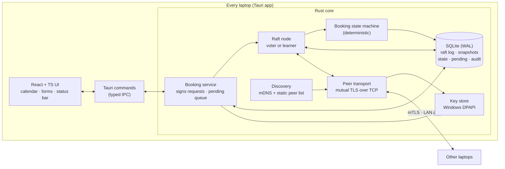
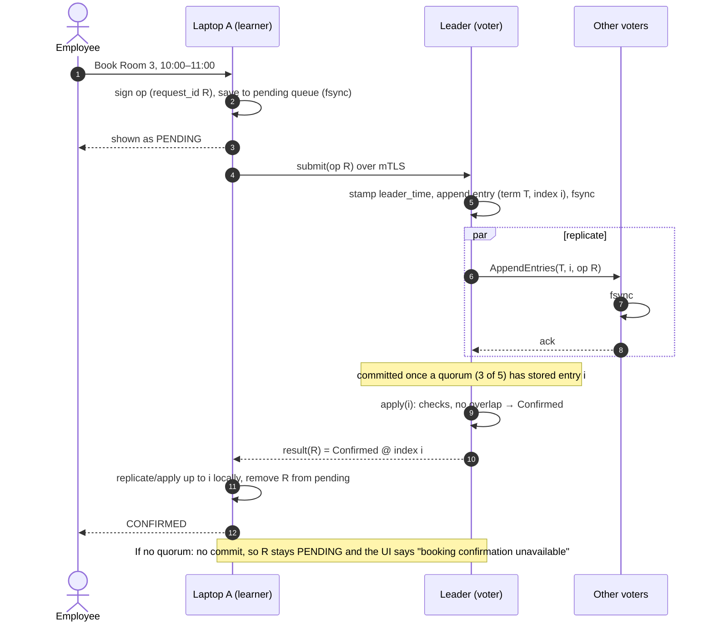

# Phase 1: Architecture and consistency design

Offline-first, serverless employee room booking over an isolated LAN.

Status: **design for review. No code yet.** Everything here must be agreed before Phase 2.
This system is separate from the Supabase web app on `main`; it lives under `p2p/` on this branch.

---

## 1. The one rule, and what it forces

> Two employees must never both hold a confirmed booking for overlapping time in the same room.

That rule decides the whole architecture, because of a hard limit (the CAP theorem):

- If two groups of laptops cannot talk to each other (a network partition), at most one group can
  keep confirming bookings. If both did, nothing could stop them confirming the same slot.
- So the system must sometimes **refuse to confirm**. It never guesses.

The design therefore chooses **safety over availability**: when coordination is impossible, laptops still
show the (clearly labelled) cached schedule and accept *pending* requests, but **nothing becomes confirmed**
until a quorum agrees.

Things that look like they'd work, and why they don't:

| Approach | Why it can double-book |
| --- | --- |
| Sync records and use last-write-wins | Both sides confirm offline; one booking is silently overwritten after the fact. |
| CRDTs | CRDTs guarantee replicas *converge*, not that a constraint ("no overlap") held when each side said yes. |
| Timestamps / "earliest request wins" | Clocks drift, and a laptop can't know whether an earlier competing request exists on a disconnected laptop. |
| "Majority of the laptops I can currently see" | Each side of a partition can see a majority *of what it sees*. Quorums must be counted against a fixed, agreed membership. |

## 2. Chosen design in one paragraph

A small, fixed set of **voter** laptops (recommended: 5) runs the **Raft** consensus protocol over a
single replicated **booking log**. Every booking action (request, modify, cancel, admin change) is an
entry in that log. An entry is **committed** once a majority of voters (3 of 5) have durably stored it. Every
laptop, voter or not, applies committed entries in log order to a **deterministic booking state
machine**, which accepts or rejects each request against the bookings that came before it. Because
every laptop applies the same entries in the same order with the same deterministic rules, every
laptop reaches the same decision. All other laptops are **learners**: they keep a full local copy for
offline viewing and submit requests, but don't vote. Peers authenticate with certificates from an
offline company CA, and every booking operation is signed by the employee who made it.

This is the brief's "designated booking authority elected from available peers, with a quorum and
fencing", done properly: the Raft **leader** is that authority, it's **elected by a majority of voters**,
and its **term number** is the fence (a deposed leader's stale term is rejected by everyone).

### Why Raft, and why an existing implementation

- Raft is a well-understood, published consensus protocol with machine-checked safety proofs
  (Ongaro & Ousterhout, *In Search of an Understandable Consensus Algorithm*, 2014; Verdi/Coq proofs).
- Writing consensus from scratch is the most common way such projects fail. We use a maintained Rust
  library and test it hard rather than inventing our own.
- **Candidate:** `openraft` (async, Tokio-based, pluggable storage and network, used in production by
  Databend). **Alternative:** `raft` (TiKV's raft-rs: older and very battle-tested, but lower level).
  Exact version, storage trait and network trait **must be verified in Phase 2** before any code depends
  on them (see §10, A1).

### Why not something else

- **Paxos per booking:** overlap is a constraint across *ranges*, not one value, so single-value Paxos doesn't
  fit. You'd end up rebuilding a replicated log anyway.
- **Byzantine fault tolerant consensus (PBFT/HotStuff):** it would tolerate a malicious voter, but it needs 3f+1
  voters, its protocols are much harder to implement correctly, and there's little mature Rust tooling for it.
  We instead limit what a compromised node can do (§7.4) and state the remaining risk honestly.
- **Blockchain:** it adds nothing here. We have a known, provisioned membership, so proof-of-work or
  proof-of-stake would only cost speed and energy.

## 3. Components



| Component | Responsibility |
| --- | --- |
| **UI** | Shows rooms, day/week calendar, my bookings, sync and quorum status, pending queue and conflicts. Never decides whether a booking is confirmed; it only displays the state machine's answer. |
| **Booking service** | Builds and signs booking operations with the employee key, stores them in the pending queue, submits them to the Raft leader, retries, and reports results. |
| **Raft node** | Leader election, log replication, commit, snapshots, and membership changes. On voters it votes and stores the log; learners only replicate. |
| **State machine** | Applies committed entries in order and enforces every booking rule. It's the only place a booking becomes confirmed or rejected. |
| **Transport** | Mutual TLS: both sides present company-CA certificates, so laptops without a certificate get nothing. |
| **Discovery** | mDNS advertises `_roombook._tcp` to find peers' IPs. Addresses are only hints; identity comes from the TLS certificate. Falls back to a manual `peers.toml`. |
| **SQLite** | Raft log and state, state-machine snapshot, materialised bookings, pending queue, and audit events. |

## 4. The booking state machine

This is the part that guarantees "no overlap". It's a pure, deterministic function:

```
apply(state, entry) -> (state', result)
```

It has no clock reads, no randomness, no network calls, and no local-only data. Same inputs give the same output
on every laptop.

### Operations (log entry payloads)

| Op | Fields | Effect if valid |
| --- | --- | --- |
| `Request` | request_id (UUIDv7), booking_id, room_id, start, end (UTC minutes), purpose, employee_id, signature | Booking becomes **Confirmed**, otherwise **Rejected(reason)** |
| `Modify` | request_id, booking_id, new room/start/end/purpose, signature | Atomically replaces the interval if the new one fits (checked **excluding itself**), otherwise **Rejected** and the old booking stays |
| `Cancel` | request_id, booking_id, signature | **Cancelled**; frees the slot |
| `Admin*` | request_id, payload, admin signature | Room create/rename/deactivate, cancel any booking, role changes, certificate revocation |
| `Config` | voters/learners change | Raft membership change (joint consensus) |

Every entry also carries `leader_time`, the leader's clock reading when it proposed the entry. The
state machine uses **only this value** for time-dependent rules such as "not in the past", so every laptop
agrees even if their clocks differ. Clock skew can make a borderline request accepted or rejected, but
can never cause an overlap.

### Validation done inside `apply`, in this order

1. **Duplicate:** if `request_id` is already in the dedupe table, return the stored result unchanged and change nothing.
2. **Authenticity:** signature verifies against the employee's certificate, the certificate chains to the company CA,
   and the certificate isn't revoked *as of this log index*.
3. **Authorisation:** employees may only Request, Modify or Cancel their own bookings. `Admin*` ops require the admin role.
4. **Well-formed:** `start < end`, whole minutes, length within limits, the room exists and is active, and `start >= leader_time`.
5. **No overlap:** for `Request` and `Modify`, there's no confirmed booking in the same room with
   `start < other.end && other.start < end`, ignoring the booking being modified. Intervals are half-open
   `[start, end)`, so 10:00–11:00 and 11:00–12:00 don't conflict.
6. Record the result in the dedupe table, append an audit event, and update the materialised `bookings` table.

## 5. Proof of consistency

### 5.1 Model and assumptions

- **Voters** `V` with `|V| = n` (recommended n = 5). **Quorum** = any subset of more than n/2 voters (3 of 5).
- **Crash-fault model:** nodes may stop, restart, lose network connectivity, and see messages delayed,
  dropped, duplicated or reordered. Nodes don't lie (the Byzantine case is in §7.4).
- **Durable storage:** a node acknowledges a log entry or a vote only after it's fsynced (SQLite WAL,
  `synchronous=FULL`). See A3 in §10.
- **No timing assumptions for safety.** Clocks and timeouts affect only liveness (whether progress happens),
  never safety.

### 5.2 Facts we rely on from Raft (proved in the Raft paper and in Verdi)

- **R1 Election safety:** at most one leader per term. Each voter durably records at most one vote per term,
  a leader needs a quorum of votes, and any two quorums share at least one voter.
- **R2 Log matching:** if two logs contain an entry with the same index and term, the logs are identical up to that index.
- **R3 Leader completeness:** a committed entry is present in the log of every leader of every later term.
- **R4 State machine safety:** if any node applies entry *e* at index *i*, no node ever applies a different entry at index *i*.

These hold only if the library implements Raft correctly. We treat that as an assumption to test (A1, §9).

### 5.3 Lemma 1: every laptop computes the same booking state

*Claim.* For every index *k*, every laptop that has applied entries 1..k holds an identical state Sₖ.

*Proof.* By R4, all laptops apply the same entry at each index. `apply` is deterministic: it uses only the previous
state and the entry (including `leader_time` and the certificate and revocation set, which are part of the state).
The base case is the same empty initial state S₀ for everyone (or the same snapshot, which is just Sₖ for some k).
By induction on k, Sₖ is identical everywhere. ∎

### 5.4 Lemma 2: no applied state ever contains two overlapping confirmed bookings in one room

*Invariant.* **NoOverlap(S):** for every room, the confirmed bookings in S have pairwise disjoint intervals.

*Proof by induction on k.*

- **Base case:** S₀ has no bookings, so NoOverlap holds.
- **Step:** assume NoOverlap(Sₖ₋₁) and apply entry k.
  - `Request`: it's confirmed only if step 5 found no overlapping confirmed booking in that room. Adding one interval
    that's disjoint from all the others keeps them pairwise disjoint. If it's rejected, the state doesn't change.
  - `Modify`: the new interval is checked against every confirmed booking in the room *except itself*,
    and the old interval is removed in the same step. The resulting set is still pairwise disjoint. If it's rejected,
    the state doesn't change.
  - `Cancel` / admin cancel: removing a booking from a set of disjoint intervals keeps it disjoint.
  - Room deactivation: existing bookings are kept and new ones refused, so the set is unchanged or shrinks.
  - Duplicate `request_id`: the state doesn't change.
  - Config, revocation and other ops don't touch the booking intervals.

  So NoOverlap(Sₖ) holds. ∎

### 5.5 Theorem 1: no double confirmation, globally

*Claim.* There's never a moment where two employees each hold a confirmation for overlapping slots in the same room.

*Proof.* A confirmation is only ever shown or returned when it's read from some Sₖ (§6). By Lemma 1, every Sₖ is the
same on every laptop, and by Lemma 2 no Sₖ contains two overlapping confirmed bookings. Suppose bookings A and B
overlap and A is confirmed in Sᵢ while B is confirmed in Sⱼ. Without loss of generality i ≤ j. If A is still
confirmed in Sⱼ, that contradicts Lemma 2. Otherwise A was cancelled at some index between i and j, which is an
explicit, signed, audited `Cancel` and not a conflict. ∎

### 5.6 Theorem 2: a partition can't confirm independently

*Claim.* If the network splits into groups P₁ and P₂, they can't both commit new booking entries.

*Proof.* Committing an entry needs a quorum of V to store it (R3/R4 rely on this). P₁ and P₂ are disjoint, so at
most one of them contains a quorum: a quorum is more than n/2 voters, and two disjoint sets can't both hold more than half.
The group without a quorum can't commit anything, so its laptops show cached data and queue pending requests (§6). ∎

The same argument covers **membership changes**. Raft's joint consensus requires a quorum of both the old and the new
voter set during the transition, so there's never a moment when two disjoint quorums are possible.

> This is why "membership" means **the voter set recorded in the committed log**, never "the peers I can
> see right now". A laptop that can see only 2 of 5 voters knows it's in a minority.

### 5.7 Theorem 3: a shown confirmation is never lost

*Claim.* If the UI shows a booking as Confirmed, it stays confirmed after crashes, restarts and leader changes,
until someone explicitly cancels or modifies it.

*Proof.* The UI shows Confirmed only after the entry is committed (§6). A committed entry is stored on a quorum
(fsynced, assumption A3), and by R3 every later leader has it, so it's never overwritten. A crashed laptop recovers by
loading its snapshot and replaying its log, then catching up from the leader. Every replay passes through
deterministic `apply`, which reproduces the same Sₖ (Lemma 1). ∎

### 5.8 Duplicates, retries, timeouts and replays

- **Duplicate or retried submission:** the client reuses the same `request_id` on every retry, including across leader
  changes and app restarts, because it's stored in the pending queue. If the entry ends up in the log twice, step 1 of
  `apply` returns the first result and changes nothing, so a retry is exactly-once in effect.
- **Unknown outcome after a timeout** (the leader crashed before replying): the client doesn't guess. It keeps the request
  *Pending* and, after reconnecting, looks up `request_id` in its own replicated state. If the result is there, that's the
  answer; if not, it resubmits with the same id.
- **Replayed network messages:** Raft discards messages with old terms or indexes. TLS 1.3 prevents replay on the wire.
- **Replayed signed operations:** an attacker who re-sends a captured signed `Request` reuses its `request_id`, which is
  already in the dedupe table, so it changes nothing. Signed operations also carry `expires_at`. Once that passes
  (`leader_time > expires_at`, default 7 days), they're rejected, so a stale request queued offline can't surprise anyone
  months later.
- **Stale leader:** a leader cut off from the majority can't commit (Theorem 2). When it reconnects, it sees a higher term
  and steps down. Its uncommitted entries are discarded and their clients still have them as pending, so they resubmit.

### 5.9 Liveness: what we do *not* promise

- Bookings confirm only when a quorum of voters can reach each other and a leader. With 5 voters, the
  system tolerates **any 2** being off or unreachable.
- No consensus protocol can guarantee progress in a fully asynchronous network (the FLP impossibility result).
  Raft makes progress once the network is stable enough for an election to finish.
- If too few voters are online (for example, after hours), **nothing can be confirmed**. Requests stay pending and the UI
  says so plainly. This is a deliberate trade-off, not a bug.

## 6. What the employee sees (offline-first behaviour)

| State | Meaning | Source |
| --- | --- | --- |
| **Cached** | "Schedule as of 10:42 (synced with 4 peers)". It may be stale. | Local Sₖ with its commit index and sync time |
| **Live** | Fresh. The leader confirmed this laptop is up to date. | Raft read-index check, then local Sₖ |
| **Pending** | Requested and signed but not yet decided. Shown hatched, **never as booked**. | Local pending queue |
| **Confirmed** | Committed and applied. | Sₖ |
| **Rejected** | Decided against, with a reason ("overlaps Board Meeting 10:00–11:00, confirmed earlier"). | Sₖ result for the `request_id` |
| **Cancelled** | Explicitly cancelled. | Sₖ |

The status bar always shows: peers connected, voters reachable (for example "3 of 5"), quorum OK or not,
leader, and the pending queue count.

**Can't be done safely offline, or in a minority partition:** confirming, modifying or cancelling a booking,
admin changes, revoking credentials, and changing voters. All of these are queued as pending (except
voter changes, which need an admin online with a quorum).

A pending cancel doesn't free the slot for anyone until it commits. That's intentional: otherwise two people
could plan around an unconfirmed gap.

## 7. Trust model and security

### 7.1 Provisioning: no internet, no trust in the LAN

1. **Company root CA:** an Ed25519 key generated once on an air-gapped machine by IT, stored on two encrypted USB
   tokens kept in separate safes for recovery. It's only used to sign intermediate and device certificates.
2. **Device enrolment, in person:** the app generates the laptop's device key locally. The private key never leaves
   the laptop and is protected with Windows DPAPI. The app exports a certificate signing request on USB; IT verifies
   it, signs a device certificate (role: voter or learner), and returns it with the CA certificate and initial voter list.
3. **Employee identity:** each employee's key is generated on their own laptop and bound to their Windows login (DPAPI, user scope).
   Its certificate holds `employee_id`, name and roles, signed by IT after checking the person face to face.
   **Identity is never just a name or an IP address.**
4. **Admin role:** a separate admin certificate. Admin ops require an admin signature, and changing roles is itself an admin op in the log.

### 7.2 On the wire

- All peer traffic uses mutual TLS 1.3 (`rustls`). A connection succeeds only if the other side's certificate chains to the
  company CA and isn't revoked. A laptop without a certificate can't even complete the handshake.
- mDNS only hints at addresses. Even if someone spoofs discovery, they still can't authenticate.
- **Revocation:** it's an `AdminRevoke` entry in the log, so revocation is itself consistent everywhere. Once applied,
  every laptop refuses that certificate for TLS and for signing.

### 7.3 At rest

- SQLite stays in the user's app-data folder with user-only file permissions. The laptop disk must be encrypted with
  BitLocker; that's a deployment requirement.
- Optional: encrypt the database file itself (SQLCipher) with a DPAPI-protected key. To be decided in Phase 2.
- **Audit:** every applied operation writes an audit event (who, what, when, log index, result). Because it's derived
  from the replicated log, it's tamper-evident: a laptop that edits its own copy disagrees with everyone else.

### 7.4 Honest limits of the security model

- Raft tolerates crashes, not lies. A **compromised voter** holding a valid certificate could misbehave, for example
  by voting twice in one term, and in theory break safety together with other faults.
- **Mitigations:**
  - Keep voters few and on IT-managed machines.
  - Make every operation employee-signed, so a malicious node can't **forge** bookings, only disrupt ordering or censor.
  - Revoke compromised certificates.
  - Keep the audit trail.
- **Full protection** needs a Byzantine fault tolerant protocol (3f+1 voters). That's out of scope, and we're recording it as a known risk.
- A stolen, unlocked laptop acts as its owner until revoked. Windows login and BitLocker are the controls there.

## 8. Booking sequence



If two employees submit overlapping requests at the same moment, the leader puts them in the log in some order.
The first one applied is Confirmed; the second is Rejected with the reason. Both laptops reach the same answer
because they apply the same log.

## 9. Database design (SQLite) and how it relates to consensus

A local SQLite transaction protects **one laptop's** files. It does not, and can't, prevent two laptops from
disagreeing. **Global consistency comes only from the Raft log.** SQLite's job is to make each laptop's part
crash-safe:

- Appending log entries and voting are fsynced before they're acknowledged.
- Applying entry *k* (updating bookings, the dedupe table and audit, then setting `last_applied = k`) happens in **one
  SQLite transaction**. A crash either leaves entry *k* fully applied or not applied at all; on restart it's applied again.

Tables (exact columns in Phase 2):

| Table | Purpose |
| --- | --- |
| `raft_state` | current_term, voted_for, last_applied, membership (durable Raft metadata) |
| `raft_log` | index (PK), term, payload (CBOR), checksum |
| `snapshots` | last_included_index/term, state blob |
| `employees` | employee_id, display name, roles, certificate, revoked_at_index |
| `peers` | device_id, certificate, role (voter/learner), last_seen_addr, revoked_at_index |
| `rooms` | room_id, name, capacity, active |
| `bookings` | booking_id, room_id, employee_id, start_min, end_min (UTC epoch minutes), purpose, status, created_index, updated_index. Index on (room_id, start_min) |
| `request_results` | request_id (PK), booking_id, result, reason, index (the dedupe table) |
| `pending_requests` | request_id (PK), signed op, created_at, attempts, last_error (this laptop only) |
| `audit_events` | index, actor, action, target, result, leader_time |
| `sync_meta` | commit_index, last_sync_at, leader_id (for the "Cached as of…" label) |
| `schema_migrations` | version, applied_at |

Everything except `raft_state`, `raft_log`, `pending_requests` and `sync_meta` is **derived** from the log, and can be
rebuilt from a snapshot plus the log.

**Times:** stored as UTC epoch minutes; conflict checks compare integers. The time zone (e.g. `Asia/Kuala_Lumpur`) is a
replicated setting used only for display and opening hours.

## 10. Assumptions to check before writing code

| # | Assumption | How we check it |
| --- | --- | --- |
| A1 | The chosen Raft library is correct and its API fits (storage, network, learners, joint consensus, snapshots) | Phase 2: pin exact version, read its docs and changelog, run its own test suite, then our partition tests |
| A2 | 5 voters, with at least 3 usually on during office hours | Ask IT and facilities which machines can be voters; consider desk PCs |
| A3 | fsync on Windows is reliable (SQLite `synchronous=FULL` on NTFS, no unsafe write caching) | Phase 5: power-pull and kill-process tests on real laptops |
| A4 | mDNS (UDP 5353) and our TCP port are allowed on the office LAN and by Windows Firewall | Test on the real network; fall back to the static peer list |
| A5 | IT can run in-person certificate enrolment and keep the CA keys offline | Agree the process with IT |
| A6 | Crash faults only for voters (no malicious voter) | Accepted risk, documented in §7.4 |
| A7 | Tauri v2 can run the Rust networking core in the background on Windows (tray, auto-start) | Phase 2 spike |
| A8 | Deterministic network simulation is feasible for tests (e.g. `turmoil` for Tokio, or our own in-memory transport) | Phase 2 spike; verify crate and API |

## 11. How we'll test the proof (Phase 3–5)

- **State machine property tests** (`proptest`): random sequences of Request/Modify/Cancel/duplicates, checking
  NoOverlap after every step and that replaying the same log gives the same state (Lemmas 1 and 2).
- **Deterministic cluster simulation:** 5 voters and N learners on a simulated network with partitions, message loss,
  duplication, reordering, crashes and restarts. Every run records a history; a checker asserts that no two
  confirmations ever overlap (Theorem 1), the minority side commits nothing (Theorem 2), and confirmed bookings survive
  restarts (Theorem 3).
- **Concurrent conflict tests:** many clients submit the same slot at once, and exactly one is Confirmed.
- **Real-LAN tests:** 3–5 Windows laptops; unplug cables, sleep laptops, kill processes, pull power.
- **Optional:** a small TLA+ model of the booking layer, model-checked with TLC, to back up the written proof.

## 12. Implementation plan (next phases)

1. **Phase 2, foundation:** Tauri v2 + React/TS/Vite shell, Rust workspace (`core` library + `app`), SQLite with
   migrations, **verified** library versions, a dev-only CA tool for local testing.
2. **Phase 3, booking:** the deterministic state machine and its tests on one laptop (no network yet),
   plus the calendar UI, forms and the pending/confirmed display.
3. **Phase 4, coordination:** Raft integration, mTLS transport, mDNS and static peers, snapshots, pending-queue retry,
   and the status bar.
4. **Phase 5, reliability and security:** simulation and fault tests, real-laptop tests, signature, authorisation and revocation tests.
5. **Phase 6, deployment:** Windows installer (offline MSI with the WebView2 runtime bundled), firewall rules,
   enrolment guide, update process (signed installers carried by IT on USB or a LAN share).

**Not production-ready until Phase 5 passes.** Any earlier build is a prototype and must be labelled as one.

## 13. Decisions needed from you

1. **Voters:** which 5 machines (or 3 for a smaller office)? They should be the most often switched on.
2. **When there's no quorum:** we propose "pending only, nothing confirmed". This is the only safe choice; please confirm it's acceptable.
3. **Provisioning:** who in IT holds the CA keys and runs enrolment?
4. **Raft library:** `openraft` (recommended) or `raft-rs`. To be confirmed after the Phase 2 version check.
